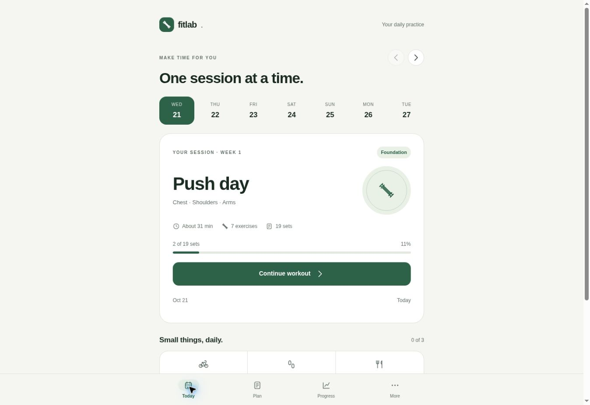

# FitLab v12.4 audit

Scope: the complete static application, all 84 days of the program, every workout block, storage and data migration, exercise alternatives, progress views, accessibility, PWA caching, and Garmin exports.

## Confirmed defects corrected

| Finding | Resolution |
| --- | --- |
| Checking the first set throws `Cannot read properties of undefined (reading 'amrap')` | The current-session suggestion receives a valid rep range. Reproduced on the original live app and covered by a reload regression. |
| UTC dates select tomorrow's workout in the evening | Calendar keys use the device's local date; schedule arithmetic is independent of DST. Future legacy start dates are normalized without deleting logs. |
| Changing lb/kg relabels existing numbers without converting them | Converts saved exercise loads, remembered loads, and bodyweight together. |
| Debounced writes can be lost on immediate exit; storage failures are silent | Immediate writes, lifecycle flushes, visible failures, and preservation of unreadable original data. |
| Start-date picker silently moves workout history | Explicit Update action and confirmation when history exists. |
| Restart has no recovery path | Save a recovery copy before restart; offer full JSON backup and validated restore. |
| Invalid weights/reps can be marked complete | Validate checked sets, support explicit zero bodyweight, and require edited completed sets to be rechecked. |
| A partial previous workout can trigger an automatic weight increase | Require all prescribed sets at the same load to reach the target. Removed unvalidated cross-exercise load ratios. |
| Exercise swaps can share a second exercise's log, hide completed sets, or falsely map an equipment variation | Reject duplicate exercise slots and swaps after logging; repair legacy conflicts without deleting sets; export historical replaced exercises once; remove inaccurate aliases. |
| Rest timers drift while backgrounded and reset on reload | Persist a wall-clock deadline and reconcile it on resume. |
| Supersets trigger rest between both halves | Start automatic rest after a complete round. |
| Backdated bodyweights become the latest reading; corrections duplicate dates | Sort by calendar date and update one measurement per date. |
| FIT header advertises protocol 0.2 rather than 2.0 | Encode `0x20`; validate checksums and records with the official Garmin SDK. |
| FIT set timestamps can extend beyond session end | Use one duration calculation for both set timeline and session timing. |
| FIT null numeric fields become zero instead of invalid sentinels | Encode absent values using the FIT invalid value for each field type. |
| Service worker deletes unrelated caches, caches error responses, and serves HTML as missing assets | Restrict cache ownership, avoid failed-response writes, and limit HTML fallback to the app entry routes. Review pages cannot overwrite the offline shell. |
| Zoom disabled; missing input names, focus trapping, and keyboard affordances | Restore zoom, label every set input, add visible focus, trap/restore modal focus, support reduced motion. |

## Numeric entry follow-up

The initial audit filled input values directly and therefore did not establish that tapping a field opened it for editing. The user reported that the pounds field would not open the keyboard. Live review reproduced a tap leaving the weight field unfocused, while direct keyboard entry through an automation locator succeeded.

Global smooth scrolling was also removed after live checks showed a tap landing on a different row while the viewport was moving. Explicit review scrolling remains available.

The root cause was the delegated theme selector `[data-theme]`, which also matched the `<html data-theme="light">` ancestor. Ordinary clicks invoked theme switching and rebuilt the app. This removed focused fields, canceled native form submission, and reset disclosure toggles. Theme actions now match only `button[data-theme]`. Tests now click real submit buttons and summary elements; directly dispatching submit events had bypassed the defect.

Numeric fields now use ordinary editable text inputs with decimal/numeric keyboard hints and synchronous focus in the tap handler. Validation remains in application code, including integer reps, numeric ranges, and decimal-comma normalization. Regression checks now cover direct taps, character-by-character edits, clearing and replacing completed values, reload, bodyweight, and measurements. After the v12.4 deployment, live browser checks confirmed direct tap and normal keyboard entry of pounds and reps, set completion, reload, and reopening the saved set. Real Save-button clicks worked in Progress and Today, including correction of an existing entry. Program settings and backup disclosures stayed open, and exercise search retained focus while typing. A physical iPhone keyboard still requires device verification; JSDOM does not model a virtual keyboard.

## Design changes

- A warm neutral interface with one green accent, restrained borders, consistent typography and spacing, and light/dark/system appearance settings.
- Today leads with the session, a compact week strip and one primary action. Setup, duplicate instructions, and export controls no longer compete with it.
- Workouts show clear weight/reps/check columns. Form cues and substitutes are disclosed on demand. Navigation preserves the originating Plan or Progress screen.
- Plan shows a readable selectable week, with all 12 weeks still accessible.
- Progress separates bodyweight trends, session history, optional body-fat estimates, and exports.
- More provides appearance, unit conversion, program settings, exercise search, practical usage guidance, and backups.
- The exercise library is accessible again. Failed remote photos receive a useful fallback; text instructions remain available.
- Removed unsupported calorie-burn guarantees and aggressive body-fat messaging from the UI. Existing exercise programming is preserved.

## Validation

- 31 automated checks pass, including the program matrix and official FIT decoder.
- Node's test runner with JSDOM exercises real application event handlers, rendering and persistence.
- A matrix renders all 84 days and all workout blocks before/after logging.
- Regression cases cover reload, local dates/DST, units, invalid input, supersets, background timers, swaps, measurements, progression, migration, backups, storage failures, schedule confirmation, theme and modal focus.
- FIT files are decoded with `@garmin/fitsdk`; TCX is parsed as XML.
- Service-worker tests cover offline navigation, cache ownership, HTTP errors, scope, and missing assets.
- `tests/viewports.html` runs the real app at 320, 390 and 768 CSS-pixel widths; live review confirmed the layouts.
- Production checks verified preserved sets, continued logging, local calendar dates, light/dark appearance, Plan and Progress. GitHub CI and Pages deployment both completed successfully.

## Practical limits

The application still stores history in the current browser; it does not sync automatically between devices. The update retains the `fitlab_v1` storage key. The agent cannot inspect the user's phone-local history, so migration is tested with representative legacy data. Exported activity timing and calories are estimates; Garmin Connect account-side import is not exercised by these tests. Browser review does not substitute for testing a physically installed iPhone PWA while locked or offline.

Garmin protocol reference: https://developer.garmin.com/fit/protocol/
